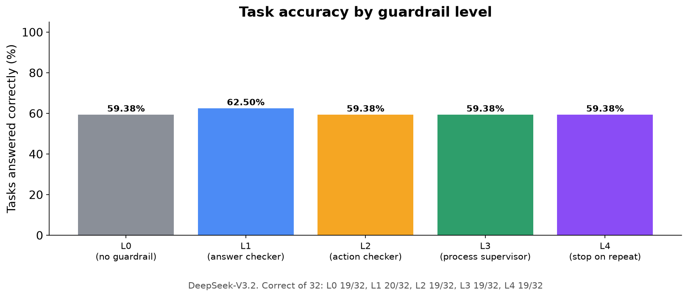
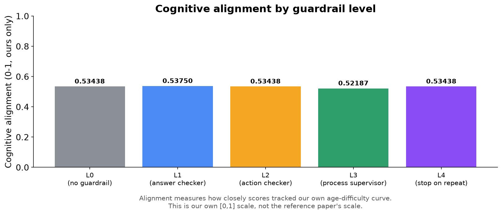
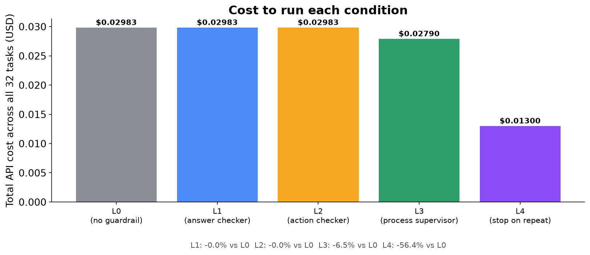
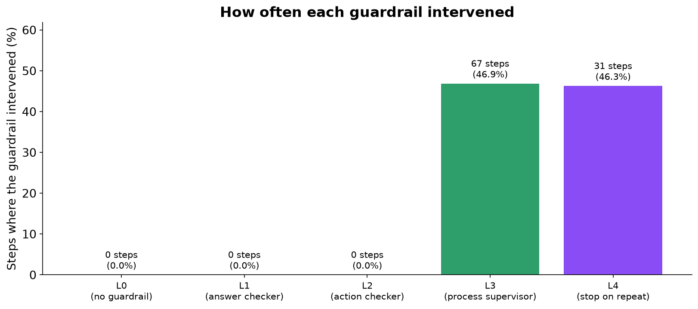
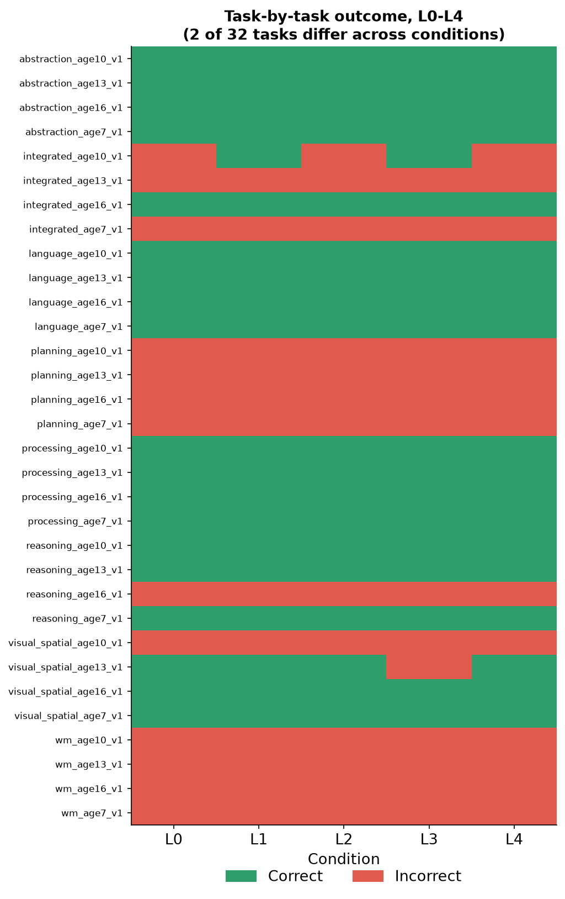
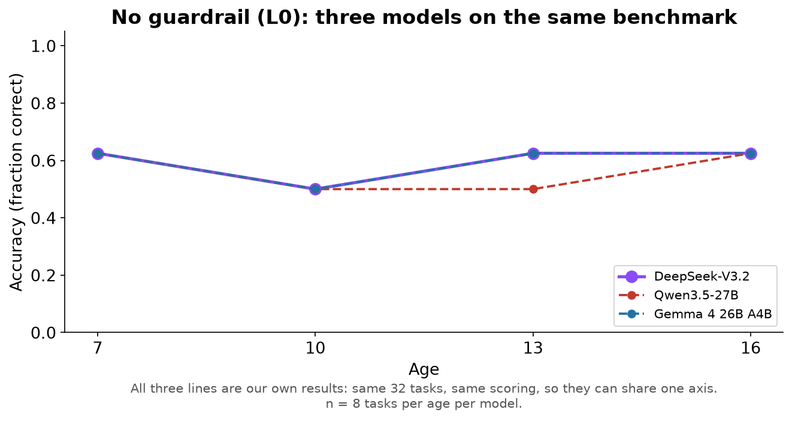
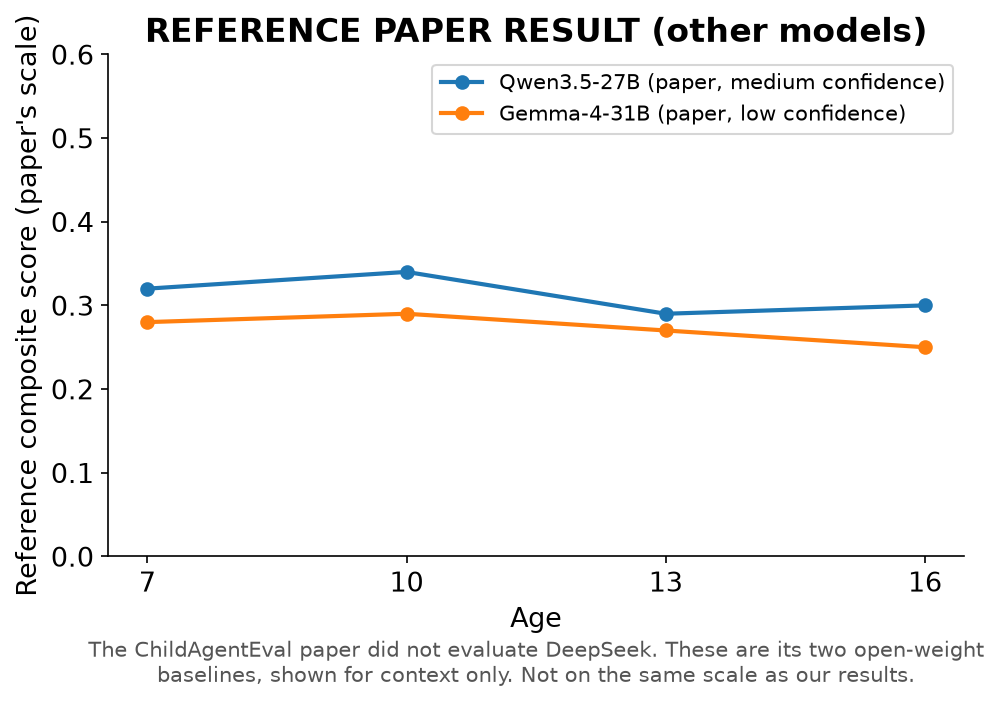
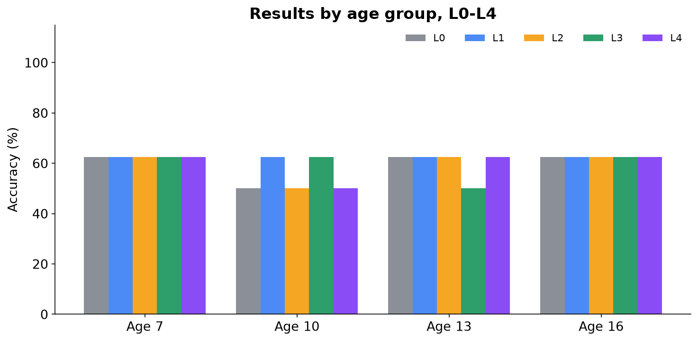
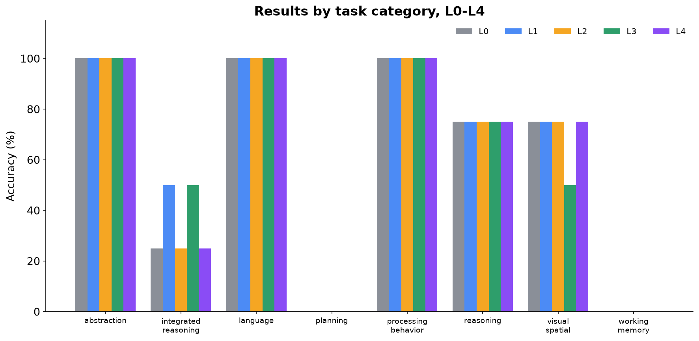

# Can Cognitive Guardrails Change AI Behavior?

### An Experimental Study with DeepSeek-V3.2 — L0 through L4

> This is an **independent, original benchmark** inspired by the publicly described research direction of the ChildAgentEval paper. It is **not a reproduction of ChildAgentEval**: the official benchmark's tasks and scoring were never released publicly. It is the same 32-task benchmark and the same guardrails previously run on Qwen3.5-27B and Gemma 4 26B A4B, now run on a third model. **The original paper did not test any DeepSeek model**, so there is no paper result for it; where this document shows a paper number, it is marked **REFERENCE PAPER RESULT** and belongs to another model.

---

## Page 2 — The Research Question

**Do supervision systems ("guardrails") change what an AI agent actually does, or only how it gets there — and does the answer hold for a third model?**

```
   AI Agent  --works on-->  Task  --produces-->  Behavior
                                                      |
                                      Guardrail watches / intervenes
                                                      |
                                                      v
                                                   Outcome
```

We gave DeepSeek-V3.2 the same 32 tasks and the same five levels of supervision (L0–L4) used for Qwen and Gemma, and measured what changed: **the answers it gave**, and **the path it took to get there**.

---

## Page 3 — Why This Matters

AI agents are increasingly trusted to click buttons, fill in forms and complete multi-step tasks on their own. If you add a layer that checks the agent's output, its actions, or its overall behaviour, does the agent actually perform better, or does it just look more supervised?

Two models have already given the same answer. A third, much larger model from a different developer tests whether that pattern is about guardrails in general or about the particular models tested so far.

> This study repeats the measurement on DeepSeek-V3.2, under the same controlled conditions, and compares all three models directly.

---

## Page 4 — What We Built

```
 DeepSeek-V3.2  -->  Browser (Playwright)  -->  32 original tasks
                                                         |
                                      L0 / L1 / L2 / L3 / L4 guardrail layer
                                                         |
                                                         v
                                        Accuracy + Alignment + Cost + Steps
```

- **Model:** DeepSeek-V3.2 (`deepseek/deepseek-v3.2`) via OpenRouter, the same settings every run (temperature 0).
- **Environment:** a real Chromium browser, driven step by step by the model through generic click/type/select actions.
- **Benchmark:** the same 32 original tasks as the Qwen and Gemma studies: 8 cognitive categories at 4 target ages (7, 10, 13, 16), one task per category per age.
- **Guardrails:** five supervision conditions, all run and reported together.
- **Measurement:** every step, guardrail decision, token and dollar was logged automatically and scored afterwards.

---

## Page 5 — What Are L0, L1, L2, L3, L4?

Think of them as increasing levels of a supervisor watching someone do a job:

| Level | Analogy | What it actually checks |
|---|---|---|
| L0 | No supervisor | Nothing. The agent works alone. |
| L1 | Answer checker | Rejects malformed or broken output format before it's used. |
| L2 | Action checker | Rejects invalid or clearly premature actions (e.g. giving up on step 1). |
| L3 | Process supervisor | Watches the whole trajectory: if the agent repeats itself, it inserts a pause; after 5 steps it ends the task. |
| L4 | Stop-on-repeat supervisor | Same as L3, except that the moment the agent repeats itself, it ends the task immediately instead of pausing. |

L0 is the plain baseline every other condition is compared against.

> **Guardrail**: an automatic check that inspects an AI agent's output or behaviour and can reject, correct, or redirect it before it counts as final.

---

## Page 6 — How the Experiment Worked

- **32 tasks × 5 conditions (L0–L4) = 160 task runs**, plus a 2-task check run beforehand.
- Every task was run once under each condition, one condition after another.
- Everything was held identical across conditions **except which guardrail was active**: same model, tasks, prompts, temperature, scoring rules and step budget.
- All 160 runs completed in full, with no retries and no interruptions. Total cost: **$0.13**.

> **Trajectory**: the full step-by-step sequence of actions an agent takes while attempting a task.

> **Baseline**: the no-intervention condition (L0) that every other condition is compared against.

---

## Page 7 · Primary Result — Accuracy



### Guardrails did not change task accuracy.

**[Our Result]** L0, L2, L3 and L4 all got **19 of 32** tasks right; L1 got 20. L2 and L4 matched L0 on every single task. L1 **never intervened**, so its one extra correct task came from the model answering differently on that run, not from the guardrail.

---

## Page 8 · Primary Result — Cognitive Alignment



### No meaningful change in cognitive alignment.

> **Cognitive alignment**: our own measure of how closely an agent's per-age performance tracks the difficulty curve the benchmark was designed around, as a single [0, 1] score. It is **not the same scale or metric as the reference paper's composite score**.

**[Our Result]** Alignment was **0.534** in L0, L2 and L4, 0.538 in L1 and 0.522 in L3. Each of those small moves is one task changing result, explained on Page 10.

---

## Page 9 · The Interesting Result — L3 and L4: Efficiency






### L4 cut the work by more than half, for the third model in a row.

**[Our Result]** Only L3 and L4 intervened: **67** and **31** times, almost always because the agent clicked the same button again. Their effect was on *efficiency*:

- L3: steps 152 → 143 (**5.9% fewer**), cost **6.5% lower**
- L4: steps 152 → 67 (**55.9% fewer**), cost $0.0298 → $0.0130 (**56.4% lower**), with exactly the same answers as L0

L1 and L2 recorded **zero** interventions: DeepSeek never produced broken output or an invalid action.

---

## Page 10 — Task-by-Task Result



### 30 of 32 tasks had the same result in every condition.

The two that changed were both under L3, one up and one down, so the total stayed the same. L3 did step in on both tasks, so we checked whether it could have caused the change. It couldn't. At every step, the model was shown **exactly the same page and the same prompt** as under L0. L3's "pause" doesn't change the page, and the model isn't told what happened on earlier steps. So it simply answered differently from identical input.

> DeepSeek is mostly, but not perfectly, consistent between runs. Its three unsupervised-equivalent runs (L0, L1, L2) differed on just one task. That puts it between Qwen (no differences at all) and Gemma (up to three).

---

## Page 11 — What Does It Mean?

### What we found

- No guardrail from L1 to L4 changed DeepSeek's accuracy or alignment (paired comparisons, n = 32 tasks; L0 vs L2, L3 and L4 all differ by exactly 0; L0 vs L1 p = 0.80).
- L4 again cut steps and cost by more than half without changing a single answer.
- **All three models now show the same pattern**: guardrails change efficiency, not answers, and all three score 0% on planning and working memory because the agent isn't shown what it already clicked.



**[Our Result]** Without guardrails, the three models score almost the same in total (DeepSeek 19, Gemma 19, Qwen 18 of 32). DeepSeek's and Gemma's lines overlap at every age. They get *different* tasks right, though: DeepSeek is best at reasoning (3 of 4) and visual-spatial (3 of 4) but weakest at integrated reasoning (1 of 4, where the other two score 4 of 4).

### What we cannot claim

> > - We cannot claim guardrails "don't work" in general, only that none of the four tested changed outcomes on three models here. > - We cannot place DeepSeek on the original paper's scale: the paper never tested it. > - With one run per condition, a one-task difference can't be told apart from chance.        

### What we learned

**[Hypothesis]** DeepSeek's integrated-reasoning mistakes look like a child's mistakes: asked how many red balls there are after adding 2 to 3 red (with 2 blue also present), it answered 7, counting the blue ones. The prompt asks the model to respond like a person of the target age, so DeepSeek may be role-playing more literally than the other two models. Plausible, but not proven by this data.

---

## Page 12 — Limitations and Next Steps

### Limitations

- One run per condition.
- 32 tasks total (4 per category, 8 per age): limited statistical power.
- L1 and L2 never fired, so their effect on this model is untested, not disproven.
- An original benchmark, not a validated psychometric instrument.
- No paper reference result exists for DeepSeek.

### What to test next

- Give the agent its own action history. With three models failing planning and working memory identically, this is the clearest bottleneck in the setup.
- Repeat each condition several times per model to measure run-to-run variability properly.
- Test the role-play effect: rerun a few tasks with and without the act-your-age instruction, to see how much "accuracy" depends on how literally each model role-plays.
- Run L5 on all three models once the Qwen L5 design is settled.

> **Closing summary:** on a third model, supervision once more changed how efficiently the agent worked without changing what it got right. The result now holds across three models from three developers.

---

## Appendix — Additional Data

These figures give context and breakdowns referenced above, using the same real data.

### A1. The paper's open-weight baselines Reference Paper Result



The ChildAgentEval paper (arXiv:2605.17894) reports results for Qwen3.5-27B and Gemma-4-31B as its open-weight models. It has **no result for DeepSeek**. These two lines are shown only so this report has the same context as the Qwen and Gemma reports; they say nothing about DeepSeek and aren't on our scale.

### A2. Results by age group



Correct of 8: L0 5/4/5/5, L1 5/5/5/5, L2 5/4/5/5, L3 5/5/4/5, L4 5/4/5/5 at ages 7/10/13/16.

### A3. Results by task category



Perfect scores in abstraction, language and processing behaviour in every condition; reasoning 75% in every condition; zero in planning and working memory in every condition. Integrated reasoning (25–50%) and visual-spatial (50–75%) are where the two single-task changes show up.

---

*Independent Interactive Cognitive-Age Benchmark — not ChildAgentEval · DeepSeek-V3.2 via OpenRouter · Full technical report: benchmark_report.md*
